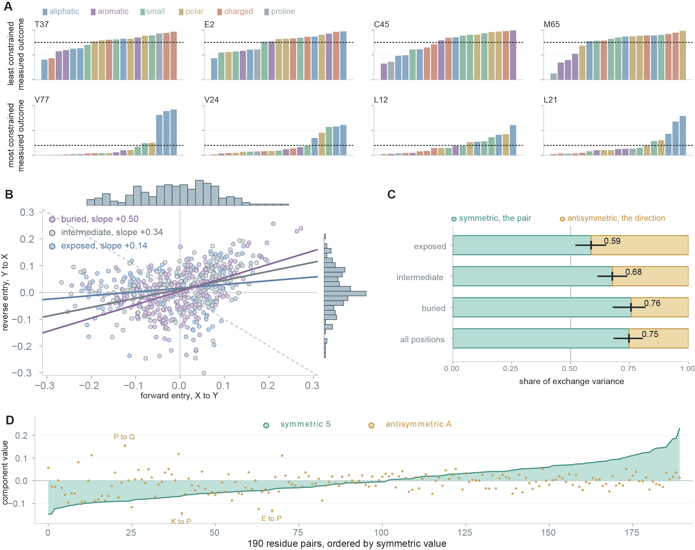
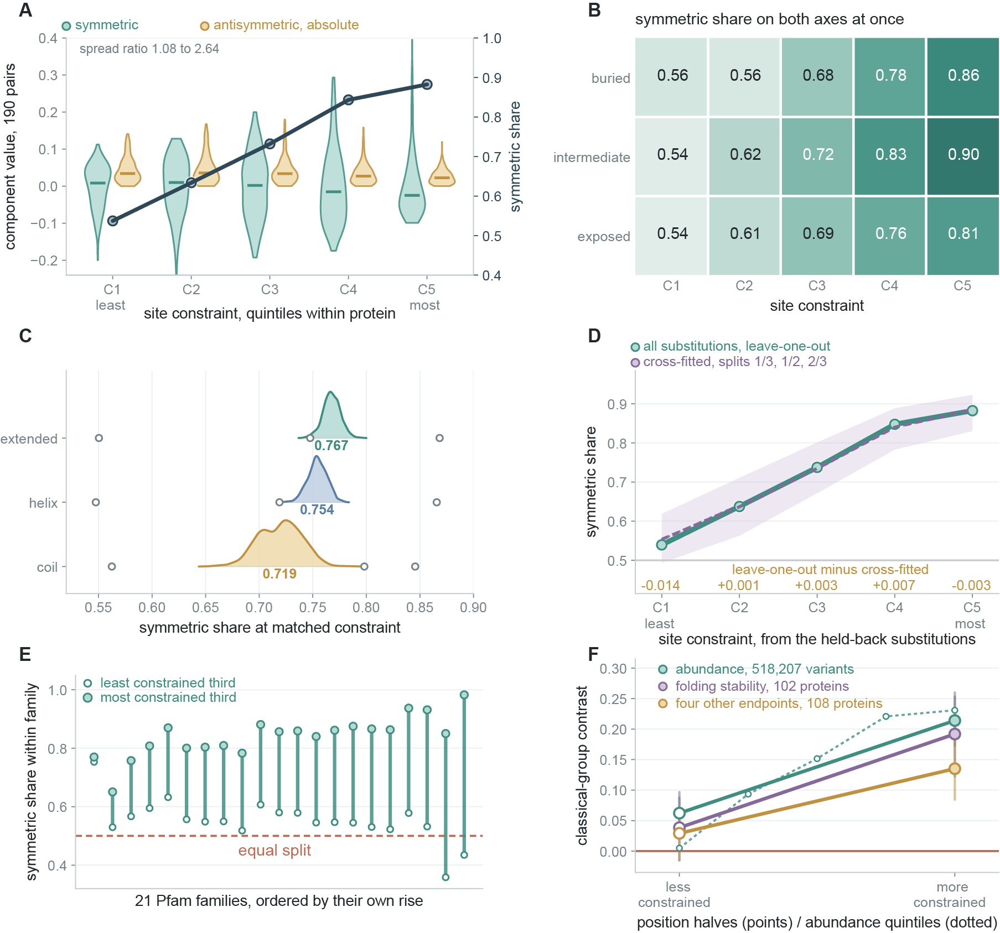
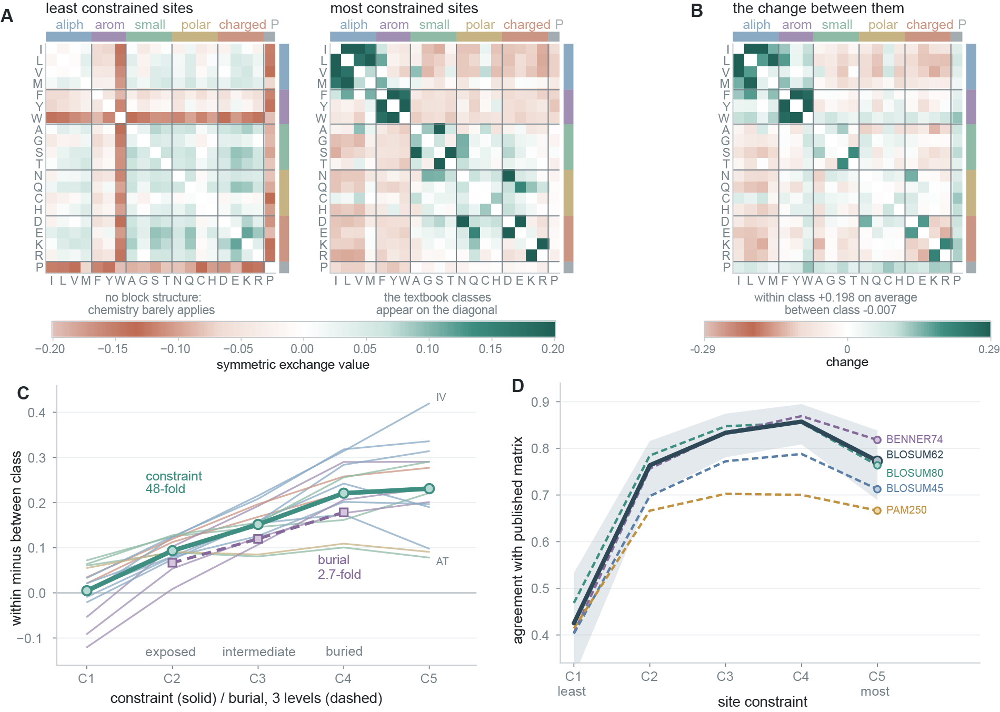
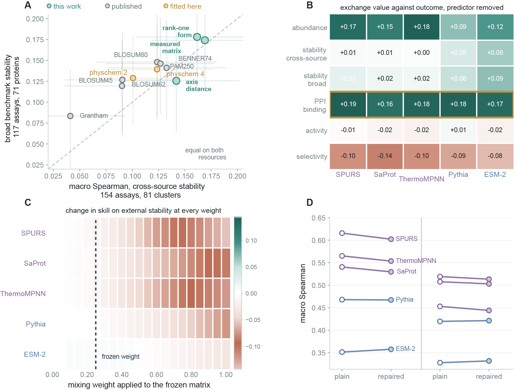

# Amino-acid exchangeability emerges with site constraint

Code and released tables for the paper. Substitution matrices in general use, PAM and
BLOSUM and the scales built on them, treat the cost of replacing one amino acid with
another as a property of the pair. We measure that premise in 518,207 substitutions across
503 human protein domains and find that the pair is the right unit for three quarters of
the variation, but that how much it matters is set by how constrained the site is.



The estimator is a within-position contrast. Each substitution is scored against the other
substitutions measured at the same position, so position tolerance, protein background and
assay scale cancel by construction rather than by adjustment. This needs near-saturation: the
resource used here has a median of 19 measured substitutions per position. Averaging the
contrasts gives a directed matrix whose X-to-Y entry comes from one set of positions and
whose Y-to-X entry comes from another, and that matrix splits into a symmetric and an
antisymmetric part.

## The result



The symmetric share rises from 0.54 to 0.88 across quintiles of site constraint. Burial and
backbone state, the variables this literature reaches for, are largely proxies for it. The
gradient survives cross-fitting, in which a position's constraint is estimated from one half
of its substitutions and the exchange contrasts from the other, so that no measurement does
both jobs; it is positive in all 21 of the 45 large families where it can be estimated
separately; and its chemical signature reproduces on two external resources, where the
within-minus-between class contrast rises by +0.153 and +0.106 against +0.152 in the
resource the law was found in.

Bounded assays censor the worst substitutions, and censoring can imitate this result: if a
pair bottoms out in both directions its two entries are pinned together, which shrinks the
directional part and inflates the share. The 27 pairs sitting against the floor are
identified from the measured values alone, then removed from every quintile at once. The
share still rises from 0.560 to 0.879, a gradient of +0.320 against +0.345 with all pairs.
`19_floor_censoring_stress_test.py` does this, and prints the random-removal null it is
compared against.



The classical chemical groups are close to absent at unconstrained positions and textbook
sharp at constrained ones, a 48-fold span in the within-class against between-class contrast.

## Using the matrix

`matrix/exchange_matrix.csv` is the frozen table: 190 unordered pairs, marginal over burial
and also conditioned on `buried`, `intermediate` and `exposed`. Higher means more readily
interchanged.

```python
import pandas as pd

table = pd.read_csv("matrix/exchange_matrix.csv")
table = table[table.burial_class == "any"]
value = {frozenset((r.residue_a, r.residue_b)): r.exchange
         for r in table.itertuples()}

value[frozenset("IV")]   #  0.2296, the most readily interchanged pair
value[frozenset("KR")]   #  0.1434
value[frozenset("PW")]   # -0.1568, the least
```

`matrix/compact_41.csv` is the rank-one form, one replaceability offset and one axis
coordinate per residue:

    exchange(a, b) = intercept + r[a] + r[b] + weight * x[a] * x[b]

with `weight = 1.02261` and `intercept = -0.002689` for the `all positions` stratum. It
reproduces the ordering of the full table at a Spearman correlation of 0.910 in sample.

On the two external stability resources the compact form is compared with the strongest
published matrix directly rather than through the full table, because chaining "the full
table beats the strongest published matrix" to "the compact form is close to the full
table" is not a valid inference. It leads BENNER74 by +0.036 on the cross-source
compilation, where it scores higher than any other scale tested, and BLOSUM80 by +0.026 on
the broad benchmark; the first is positive at a one-sided 5% level over homology clusters
and the second is not. The full table minus the compact form is -0.007 and +0.004, so the compact
form is slightly ahead on the cross-source compilation and slightly behind on the broad
benchmark; either way the intervals bound the loss from compression at about 0.035 rather
than showing the two to be equivalent.
Individual entries can differ by more than the spacing between neighbouring pairs, so use
the full table for lookups and the compact form when what you want is the structure or a
parametric term. `20_direct_comparison_stability.py` reproduces both comparisons.

The scale is validated for ranking mutational effects, and is most useful where site
constraint is high. It is not a drop-in replacement for PAM or BLOSUM in alignment scoring,
homology search or phylogenetic likelihood, none of which is tested here.



## Layout

    scripts/            analysis, numbered so that a script only ever reads or imports
                        lower-numbered ones
    matrix/             the released exchange scale
    data/               inputs; the two small ones ship here, the large ones do not
    results/            66 tables, one writer each; results/README.md is the index
    docs/               images used above

| Script | What it produces |
|---|---|
| `01_noise_corrected_and_replication.py` | noise-corrected symmetric share by structural environment |
| `02_constraint_reframe.py` | the constraint gradient, and the classical-group contrast along it |
| `03_exchange_matrix_and_validation.py` | the exchange matrix, its dimensionality, and the frozen-matrix validation |
| `04_functional_sites.py` | UniProt functional-site control for the fall at the top quintile |
| `05_verify_frozen_matrix.py` | independent re-implementation of the frozen-matrix result |
| `06_bilinear_fit.py` | the constrained bilinear fit, used by the dimensionality and ladder scripts |
| `07_rank_one_axis.py` | the single interaction axis and its loadings |
| `08_verify_spread_ratio.py` | independent re-implementation of the spread-ratio result |
| `09_endpoint_absorption.py` | what each frozen predictor has already absorbed, by endpoint |
| `10_saturation_test.py` | the equal-drop test for assay saturation |
| `11_baseline_ladder.py` | the baseline comparison against published scales, the direct comparison of the released scales with the strongest of them, and the per-assay correlations behind both |
| `12_insample_by_rank.py` | in-sample against held-out fit at each rank |
| `13_crossfit_constraint.py` | the cross-fitted constraint gradient |
| `14_family_recurrence.py` | the gradient inside single Pfam families, and the held-out family split |
| `15_external_constraint_law.py` | the same organization on two external resources |
| `16_blosum_and_residual.py` | agreement with BLOSUM62 along constraint, and what the directional quarter contains |
| `17_agreement_with_published_matrices.py` | the same agreement against five published matrices, quintile by quintile |
| `18_components_by_quintile.py` | spread of the symmetric and directional components at each quintile |
| `19_floor_censoring_stress_test.py` | the constraint law recomputed with the floor-affected pairs removed everywhere |
| `20_direct_comparison_stability.py` | released scales against the strongest published matrix, with a one-sided bootstrap |
| `21_symmetry_followups.py` | packing curve, mediation, the pairs that move most, and two smaller follow-ups |
| `22_tolerance_shape.py` | shape of the exchange distribution, tolerated set size, and the radius test |
| `23_third_external_stability.py` | the frozen matrix on a third external stability compilation |
| `24_second_endpoint_replication.py` | the same estimator on a second molecular endpoint |
| `25_family_overall_share.py` | overall symmetric share in the largest Pfam families |
| `26_within_class_pair_paths.py` | every within-class pair along the constraint axis, and the per-class summary |

The numbers are a running order that satisfies the dependencies; they are not a claim that
the analyses were done in that sequence. The estimator itself is `leave_one_out`, each
substitution scored against the mean of the others measured at the same position. It is
written out separately in several scripts, and vectorised in `13_`, so that each stands
alone; the copies are numerically identical.

`03_` and `06_` are imported as libraries by the scripts that follow them, `02_` by `19_`,
`25_` and `26_`, `10_` by `19_`, and `16_` by `17_` and `18_`. `05_` and `08_` re-derive two
load-bearing numbers without importing any of the analysis code.
`20_direct_comparison_stability.py` reads the per-assay correlations that
`11_baseline_ladder.py` writes, so run the ladder first, and `12_insample_by_rank.py` reads
the `_singlestart` tables from `06_`. Running the scripts in numeric order satisfies all of
it.


## Running it

Put the four parquet files listed in `data/README.md` into `data/`, then

    pip install -r requirements.txt
    python scripts/02_constraint_reframe.py
    python scripts/13_crossfit_constraint.py

Scripts read from `data/` and write to `results/`. Nothing needs the network: the one script
that would fetch UniProt annotations reads the snapshot shipped in `data/` instead. Every
random draw is seeded, so a rerun reproduces the published numbers exactly.

`03_exchange_matrix_and_validation.py` is the long one and runs in parts. With no argument
it runs `R2 R3 R4 R5`. A fifth part, `R5b`, sweeps the external mixing weight and has to be
asked for by name:

    python scripts/03_exchange_matrix_and_validation.py R5b

`06_bilinear_fit.py` repeats the rank sweep of `R4` with a single warm start and looser
tolerances, writing the `_singlestart` tables. Those are the ones the published
dimensionality result was drawn from, and `12_insample_by_rank.py` reads them.
